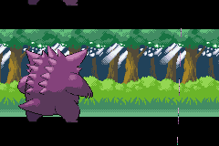
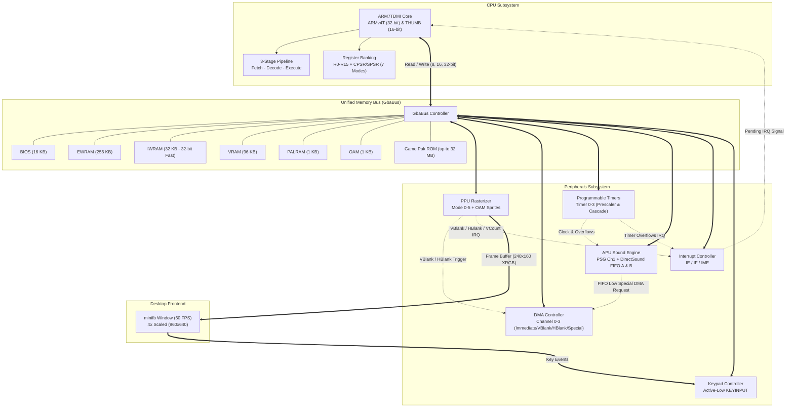
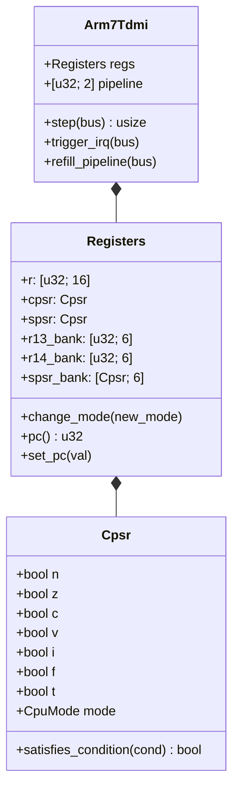
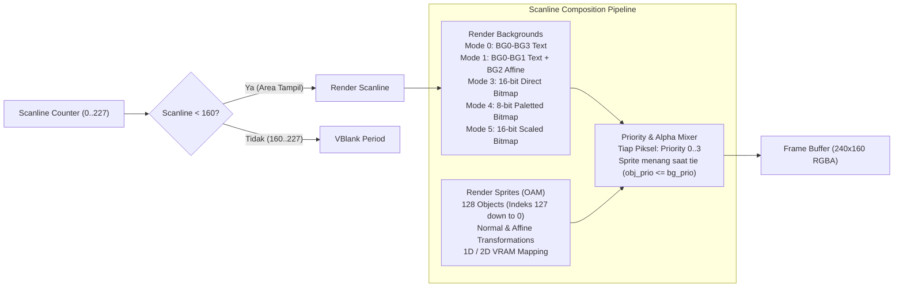
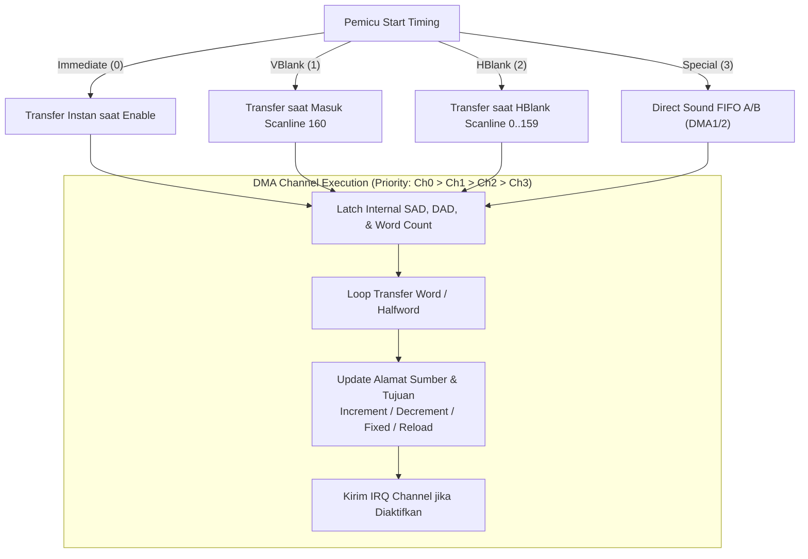
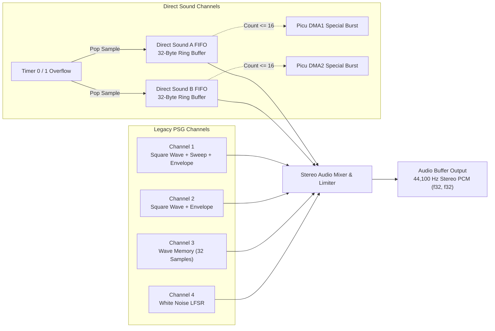
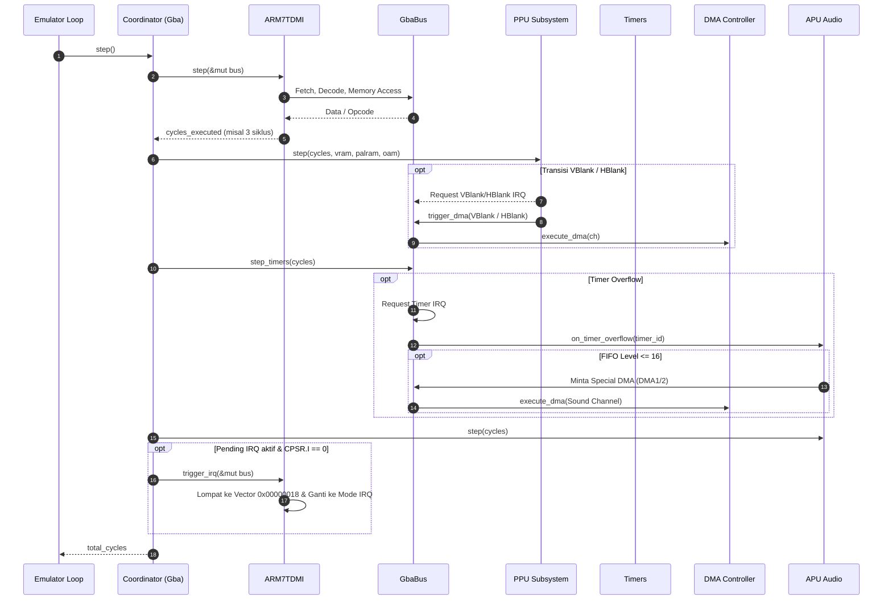

# OxideAdvance 🦀

[](https://www.rust-lang.org/)
[](LICENSE)
[]()
[-success.svg)]()
[]()

**OxideAdvance** adalah emulator Game Boy Advance (GBA) modular berkinerja tinggi yang dibangun dari awal (*from scratch*) menggunakan **Pure Rust** tanpa ketergantungan library C eksternal pada core emulasinya. 

Emulator ini mengimplementasikan emulasi siklus waktu (*cycle-synchronized*) akurat untuk CPU ARM7TDMI (ARMv4T 32-bit & THUMB 16-bit dengan 3-stage pipeline), Unified Memory Bus (MMU dengan mirroring), PPU (Tile Modes 0-2 & Bitmap Modes 3-5 dengan Sprite OAM), DMA Channels 0-3, Programmable Timers 0-3, Interrupt Controller, APU (PSG Synthesizer + DirectSound FIFO Stereo), dan Cleanroom HLE BIOS.

---

### 🎮 Commercial Game Compatibility Showcase

OxideAdvance mampu menjalankan game komersial GBA secara *out-of-the-box* (contoh: **Pokemon FireRed Version**):

| 1. Shooting Stars Intro | 2. Game Freak Logo | 3. Gengar Battle Intro |
| :---: | :---: | :---: |
|  |  |  |

---

## Daftar Isi

1. [Fitur Utama](#fitur-utama)
2. [Arsitektur Sistem](#arsitektur-sistem)
3. [Struktur Workspace](#struktur-workspace)
4. [Rincian Subsistem Hardware](#rincian-subsistem-hardware)
   - [ARM7TDMI CPU Core](#1-arm7tdmi-cpu-core)
   - [Memory Bus & Memory Map](#2-memory-bus--memory-map)
   - [PPU & Graphics Engine](#3-ppu--graphics-engine)
   - [DMA Controller](#4-dma-controller)
   - [Programmable Timers](#5-programmable-timers)
   - [Audio Processing Unit (APU)](#6-audio-processing-unit-apu)
   - [Interrupt Controller](#7-interrupt-controller)
   - [Keypad Controller](#8-keypad-controller)
5. [Siklus Sinkronisasi Emulasi (Cycle-Stepping)](#siklus-sinkronisasi-emulasi-cycle-stepping)
6. [Peta Register I/O GBA](#peta-register-io-gba)
7. [Kontrol Keyboard Desktop](#kontrol-keyboard-desktop)
8. [Cara Kompilasi & Menjalankan](#cara-kompilasi--menjalankan)
9. [Pengujian & Verifikasi](#pengujian--verifikasi)

---

## Arsitektur Sistem

Seluruh sistem dirancang secara terdekopel di mana `GbaBus` bertindak sebagai bus bersama yang menghubungkan CPU, PPU, DMA, Timer, Interrupts, dan APU tanpa *borrow conflicts* dan tanpa `unsafe`.



---

## Struktur Workspace

Proyek ini menggunakan Cargo Workspace yang memisahkan logika inti emulasi dari layer I/O antarmuka pengguna:

```text
.
├── Cargo.toml                       # Root Workspace Configuration
├── crates
│   ├── gba-core                     # Core Emulasi GBA (Pure Rust, no_std friendly, Zero C deps)
│   │   ├── Cargo.toml
│   │   └── src
│   │       ├── lib.rs               # Library root & module exports
│   │       ├── gba.rs               # Master GBA System Coordinator
│   │       ├── cpu/                 # ARM7TDMI Core
│   │       │   ├── mod.rs           # Arm7Tdmi struct, pipeline, & IRQ dispatch
│   │       │   ├── cpsr.rs          # CPSR/SPSR status flags & condition evaluator
│   │       │   ├── registers.rs     # Banked register storage (User, FIQ, IRQ, SVC, etc.)
│   │       │   ├── alu.rs           # Barrel Shifter & 16 ALU Operations
│   │       │   ├── arm/             # 32-bit ARM instruction decoder & executor
│   │       │   └── thumb/           # 16-bit THUMB instruction decoder (Formats 1-19)
│   │       ├── bus/                 # Memory Bus & Memory Map
│   │       │   ├── mod.rs           # Bus Trait & Unaligned access logic
│   │       │   └── memory.rs        # GbaBus, mirroring, & I/O dispatch
│   │       ├── ppu/                 # Picture Processing Unit
│   │       │   └── mod.rs           # Scanline rasterizer, Modes 0-5, Sprites/OBJ
│   │       ├── dma/                 # Direct Memory Access
│   │       │   └── mod.rs           # DMA Channels 0-3 & timing triggers
│   │       ├── timers/              # Timers
│   │       │   └── mod.rs           # Timers 0-3, Prescalers, & Cascade mode
│   │       ├── apu/                 # Audio Processing Unit
│   │       │   └── mod.rs           # DirectSound FIFO A/B, PSG Ch1, & Stereo Mixer
│   │       ├── interrupts/          # Interrupt Controller
│   │       │   └── mod.rs           # IE, IF, IME registers & IRQ masking
│   │       └── keypad/              # Keypad Controller
│   │           └── mod.rs           # KEYINPUT (active-low) & KEYCNT
│   └── gba-desktop                  # Native Desktop GUI & CLI Launcher
│       ├── Cargo.toml
│       └── src
│           └── main.rs              # minifb GUI window, 60 FPS loop, & interactive demo
└── README.md
```

---

## Rincian Subsistem Hardware

### 1. ARM7TDMI CPU Core

ARM7TDMI merupakan mikroprosesor RISC 32-bit yang mendukung dua set instruksi: **ARMv4T** (32-bit) dan **THUMB** (16-bit kompak).



#### Fitur & Karakteristik Utama CPU:
- **3-Stage Pipeline (Fetch-Decode-Execute)**:
  - Disimulasikan dengan buffer `pipeline: [u32; 2]`.
  - Pada arsitektur ARM7TDMI, saat instruksi dieksekusi, nilai register `PC` (R15) terbaca **8 byte di depan** (pada mode ARM) atau **4 byte di depan** (pada mode THUMB).
  - Melakukan *pipeline refill* saat terjadi branch, branch with link, mode exchange (BX), atau exception.
- **Register Banking**:
  - Menyimpan register aktif dalam array flat `r: [u32; 16]`.
  - Pergantian mode CPU (`User`, `FIQ`, `IRQ`, `Supervisor`, `Abort`, `Undefined`, `System`) menukar register banked (`R13_sp`, `R14_lr`, dan `R8_fiq..R12_fiq`) secara branchless $O(1)$.
- **ALU & Barrel Shifter**:
  - Implementasi 16 operasi ALU ARM (`AND`, `EOR`, `SUB`, `RSB`, `ADD`, `ADC`, `SBC`, `RSC`, `TST`, `TEQ`, `CMP`, `CMN`, `ORR`, `MOV`, `BIC`, `MVN`).
  - Mendukung 5 tipe shift: LSL (Logical Shift Left), LSR (Logical Shift Right), ASR (Arithmetic Shift Right), ROR (Rotate Right), dan RRX (Rotate Right Extended with Carry).
  - Penanganan aturan Carry ARM pada operasi pengurangan: Carry flag bertindak sebagai **Not-Borrow** ($C=1$ jika $a \ge b$, $0$ jika terjadi pinjaman/borrow).
- **Decoder Lengkap**:
  - Set instruksi ARM 32-bit: Data Processing, Multiply/Multiply-Accumulate, Single Data Transfer (LDR/STR), Halfword/Signed Transfer (LDRH/STRH/LDRSB/LDRSH), Block Data Transfer (LDM/STM dalam mode IA/IB/DA/DB dengan pemulihan CPSR dan transfer bank User), Branch & Link (B/BL), Branch Exchange (BX), Status Register Access (MRS/MSR), dan Software Interrupt (SWI).
  - Set instruksi THUMB 16-bit: Formats 1 hingga 19 lengkap mencakup ALU hi-register, PC-relative load, push/pop dengan reload PC/LR, dan unconditional/conditional branches.

---

### 2. Memory Bus & Memory Map

Bus memori memetakan ruang alamat fisik 32-bit GBA (`0x0000_0000..=0x0FFF_FFFF`) dengan perlakuan hardware khusus.

| Rentang Alamat | Ukuran | Deskripsi & Hak Akses | Karakteristik Hardware |
| :--- | :--- | :--- | :--- |
| `0x0000_0000..=0x0000_3FFF` | 16 KB | System ROM / BIOS | Read-Only. Terproteksi saat eksekusi di luar BIOS |
| `0x0200_0000..=0x0203_FFFF` | 256 KB | On-board WRAM (EWRAM) | Read/Write 16-bit bus (mirrored hingga `0x02FF_FFFF`) |
| `0x0300_0000..=0x0300_7FFF` | 32 KB | On-chip WRAM (IWRAM) | Read/Write 32-bit bus super cepat (mirrored hingga `0x03FF_FFFF`) |
| `0x0400_0000..=0x0400_03FF` | 1 KB | I/O Registers | Register hardware PPU, DMA, Timer, APU, Keypad |
| `0x0500_0000..=0x0500_03FF` | 1 KB | Palette RAM (PALRAM) | 512 byte BG palette + 512 byte OBJ palette |
| `0x0600_0000..=0x0601_7FFF` | 96 KB | Video RAM (VRAM) | BG tilemaps, character data, bitmap framebuffers |
| `0x0700_0000..=0x0700_03FF` | 1 KB | Object Attribute Memory (OAM) | 128 entri atribut sprite + 32 set matriks affine |
| `0x0800_0000..=0x09FF_FFFF` | Max 32 MB | Game Pak ROM (Waitstate 0) | Akses kartrid ROM game |
| `0x0A00_0000..=0x0BFF_FFFF` | Max 32 MB | Game Pak ROM (Waitstate 1) | Mirror Waitstate 1 |
| `0x0C00_0000..=0x0DFF_FFFF` | Max 32 MB | Game Pak ROM (Waitstate 2) | Mirror Waitstate 2 |
| `0x0E00_0000..=0x0E00_FFFF` | 64 KB | Game Pak SRAM / Flash backup | Penyimpanan save data baterai |

#### Hardware Quirks yang Diimplementasikan:
1. **ARMv4T Unaligned 32-bit Read Rotation**:
   Pembacaan 32-bit (`LDR`) dari alamat yang tidak kelipatan 4 (`addr & 3 != 0`) tidak menyebabkan fault. Hardware membaca word 32-bit pada alamat `addr & !3`, kemudian melakukan perputaran bit ke kanan (*Rotate Right*) sebesar `(addr & 3) * 8` bit.
2. **Duplikasi Penulisan 8-bit ke VRAM & PALRAM**:
   Penulisan 8-bit ke PALRAM atau VRAM diduplikasi oleh hardware bus menjadi halfword 16-bit `val | (val << 8)` dan ditulis ke alamat halfword genap terdekat.
3. **Penulisan 8-bit ke OAM Diabaikan**:
   Hardware GBA mengabaikan penulisan byte tunggal ke OAM; hanya penulisan 16-bit atau 32-bit yang valid.

---

### 3. PPU & Graphics Engine

PPU GBA bekerja berdasarkan rasterisasi garis pindai (*scanline rasterizer*) dengan resolusi layar $240 \times 160$ piksel.



#### Karakteristik Grafis:
- **Timing Layar**:
  - 1 scanline = 1232 siklus CPU (960 siklus gambar HDRAW + 272 siklus HBLANK).
  - 1 frame = 228 scanlines (160 scanlines tampil + 68 scanlines VBLANK) = **280,896 siklus CPU per frame** (~59.73 Hz).
- **Mode Latar Belakang (BG Modes)**:
  - **Mode 0**: 4 Background teks independen (BG0–BG3), ukuran peta 32x32 hingga 64x64 tile, 4bpp (16 warna) atau 8bpp (256 warna), pembalikan horizontal/vertikal per tile, dan scrolling hardware per piksel via `BGnHOFS`/`BGnVOFS`.
  - **Mode 1**: Mode campuran (BG0 teks, BG1 teks, BG2 affine rotasi/skala).
  - **Mode 3**: Bitmap warna langsung 16-bit BGR555 berukuran penuh $240 \times 160$.
  - **Mode 4**: Bitmap 8-bit berpalet dengan dukungan *page flipping* (Frame 0 di `0x0600_0000`, Frame 1 di `0x0600_A000`).
  - **Mode 5**: Bitmap warna langsung 16-bit $160 \times 128$ dengan *page flipping*.
- **Hardware Sprite (OBJ) Engine**:
  - Menguraikan seluruh 128 entri OAM (masing-masing 8 byte).
  - Mendukung ukuran $8 \times 8$ hingga $64 \times 64$ dengan bentuk Persegi (*Square*), Mendatar (*Horizontal*), dan Tegak (*Vertical*).
  - Mode pemetaan karakter 1D linier contiguous dan 2D matrix ($32 \times 32$ tile).
  - Mendukung 32 grup matriks transformasi Affine ($PA, PB, PC, PD$) untuk rotasi dan penskalaan sprite arbitrer.
  - Resolusi prioritas inter-sprite: indeks OAM lebih kecil selalu menang (OBJ 0 > OBJ 1 > ... > OBJ 127).

---

### 4. DMA Controller

DMA Controller GBA menyediakan 4 channel transfer memori berkecepatan tinggi tanpa intervensi CPU.



#### Spesifikasi Channel DMA:
- **Channel 0**: Prioritas tertinggi. Terbatas pada memori internal (tidak dapat mengakses ROM atau SRAM).
- **Channel 1 & 2**: Digunakan khusus untuk streaming audio Direct Sound FIFO A & B.
- **Channel 3**: Channel umum dengan kapasitas hitung word hingga 64K ($65,536$ transfer), mendukung transfer Cartridge ROM dan Game Pak DRQ.
- **Siklus Bus**: Menghabiskan 2 siklus inisialisasi + 2 siklus per transfer word/halfword, memajukan siklus sistem secara sinkron.

---

### 5. Programmable Timers

GBA memiliki 4 timer presisi 16-bit (Timer 0–3):

- **Prescaler Clock**:
  - `00b`: System Clock ($16.78\text{ MHz}$, 1 siklus per tick)
  - `01b`: System Clock / 64 (64 siklus per tick)
  - `10b`: System Clock / 256 (256 siklus per tick)
  - `11b`: System Clock / 1024 (1024 siklus per tick)
- **Cascade Mode (Count-up Timing)**:
  - Pada Timer 1, 2, dan 3, bit 2 `TMnCNT_H` mengabaikan prescaler internal dan menaikkan counter hanya ketika timer sebelumnya mengalami *overflow* ($0\text{xFFFF} \to 0\text{x0000}$).
- **Integrasi Audio & Interrupt**:
  - *Overflow* Timer 0 dan Timer 1 berfungsi sebagai *sample rate clock* untuk Direct Sound FIFO A & B.
  - Memicu interupsi IRQ Timer terkait saat bit IRQ Enable aktif.

---

### 6. Audio Processing Unit (APU)

Sistem audio GBA menggabungkan sintesis PSG warisan Game Boy klasik dengan dua saluran streaming PCM Direct Sound modern.



---

### 7. Interrupt Controller

Interrupt Controller menangani pengiriman exception hardware ke ARM7TDMI Core:
- **Register `IE` (`0x0400_0200`)**: Interrupt Enable bitmask.
- **Register `IF` (`0x0400_0202`)**: Interrupt Request Flag (*Write-1-to-Clear*).
- **Register `IME` (`0x0400_0208`)**: Master Interrupt Enable (bit 0).
- **Pemetaan Bit Interupsi GBA**:
  - Bit 0: LCD VBlank
  - Bit 1: LCD HBlank
  - Bit 2: LCD V-Counter Match
  - Bit 3: Timer 0 Overflow
  - Bit 4: Timer 1 Overflow
  - Bit 5: Timer 2 Overflow
  - Bit 6: Timer 3 Overflow
  - Bit 8: DMA 0 Complete
  - Bit 9: DMA 1 Complete
  - Bit 10: DMA 2 Complete
  - Bit 11: DMA 3 Complete
  - Bit 12: Keypad Interrupt

---

### 8. Keypad Controller

Register `KEYINPUT` (`0x0400_0130`) memetakan 10 tombol fisik konsol dengan logika **Active-Low** (bit bernilai `0` saat tombol ditekan, dan `1` saat dilepas).

```text
Bit 0: Tombol A
Bit 1: Tombol B
Bit 2: Select
Bit 3: Start
Bit 4: Panah Kanan
Bit 5: Panah Kiri
Bit 6: Panah Atas
Bit 7: Panah Bawah
Bit 8: Tombol R (Shoulder)
Bit 9: Tombol L (Shoulder)
```

---

## Siklus Sinkronisasi Emulasi (Cycle-Stepping)

Setiap panggilan ke `Gba::step()` memajukan CPU sebanyak satu instruksi, kemudian mendistribusikan jumlah siklus CPU tersebut ke seluruh periferal hardware:



---

## Peta Register I/O GBA

| Alamat | Simbol | Ukuran | R/W | Deskripsi |
| :--- | :--- | :---: | :---: | :--- |
| `0x0400_0000` | `DISPCNT` | 16-bit | R/W | Kontrol Tampilan LCD & Mode BG (0–5) |
| `0x0400_0004` | `DISPSTAT` | 16-bit | R/W | Status LCD, IRQ Enable, & V-Count Target |
| `0x0400_0006` | `VCOUNT` | 16-bit | R | Garis Pindai (*Scanline*) Saat Ini ($0..227$) |
| `0x0400_0008` | `BG0CNT` | 16-bit | R/W | Kontrol Background 0 |
| `0x0400_000A` | `BG1CNT` | 16-bit | R/W | Kontrol Background 1 |
| `0x0400_000C` | `BG2CNT` | 16-bit | R/W | Kontrol Background 2 |
| `0x0400_000E` | `BG3CNT` | 16-bit | R/W | Kontrol Background 3 |
| `0x0400_0010` | `BG0HOFS` | 16-bit | W | Offset Scroll Horizontal BG0 |
| `0x0400_0012` | `BG0VOFS` | 16-bit | W | Offset Scroll Vertikal BG0 |
| `0x0400_0060` | `SOUND1CNT_L` | 16-bit | R/W | Channel 1 Sweep Control |
| `0x0400_0062` | `SOUND1CNT_H` | 16-bit | R/W | Channel 1 Duty Cycle & Envelope |
| `0x0400_0064` | `SOUND1CNT_X` | 16-bit | R/W | Channel 1 Frequency & Start |
| `0x0400_0080` | `SOUNDCNT_L` | 16-bit | R/W | Master PSG Volume & Stereo Panning |
| `0x0400_0082` | `SOUNDCNT_H` | 16-bit | R/W | Direct Sound Volume, Timer Select, & FIFO Reset |
| `0x0400_0084` | `SOUNDCNT_X` | 16-bit | R/W | Master Sound Enable (Bit 7) & Status |
| `0x0400_00A0` | `FIFO_A` | 32-bit | W | Port Masukan 32-bit Direct Sound FIFO A |
| `0x0400_00A4` | `FIFO_B` | 32-bit | W | Port Masukan 32-bit Direct Sound FIFO B |
| `0x0400_00B0` | `DMA0SAD` | 32-bit | W | DMA Channel 0 Source Address |
| `0x0400_00B4` | `DMA0DAD` | 32-bit | W | DMA Channel 0 Destination Address |
| `0x0400_00B8` | `DMA0CNT_L` | 16-bit | W | DMA Channel 0 Word Count |
| `0x0400_00BA` | `DMA0CNT_H` | 16-bit | R/W | DMA Channel 0 Control & Enable |
| `0x0400_0100` | `TM0CNT_L` | 16-bit | R/W | Timer 0 Counter (R) / Reload Value (W) |
| `0x0400_0102` | `TM0CNT_H` | 16-bit | R/W | Timer 0 Control (Prescaler, IRQ, Start) |
| `0x0400_0130` | `KEYINPUT` | 16-bit | R | Input Status Tombol Game Boy Advance (*Active-Low*) |
| `0x0400_0200` | `IE` | 16-bit | R/W | Interrupt Enable Register |
| `0x0400_0202` | `IF` | 16-bit | R/W | Interrupt Request Flag (*Write-1-to-Clear*) |
| `0x0400_0208` | `IME` | 16-bit | R/W | Master Interrupt Enable Register (Bit 0) |

---

## Kontrol Keyboard Desktop

Aplikasi desktop `gba-desktop` memetakan tombol fisik keyboard ke tombol konsol GBA:

| Tombol GBA | Tombol Keyboard | Fungsi pada Mode Demo |
| :--- | :--- | :--- |
| **D-Pad (Atas / Bawah / Kiri / Kanan)** | Tombol Panah Keyboard | Gerak Sprite Kursor & Hardware Scrolling (Mode 0) / Gerak Kursor (Mode 3) |
| **Tombol A** | `Z` | Ubah palet / aksi kursor |
| **Tombol B** | `X` | Aksi sekunder |
| **Start** | `Enter` | Tombol Start GBA |
| **Select** | `Backspace` atau `Spasi` | Tombol Select GBA |
| **Shoulder L / R** | `A` / `S` | Modulasi palet warna plasma (Mode 3) |
| **Toggle Mode** | `Tab` | Beralih instan antara **Mode 0 (Tilemap + Sprite)** dan **Mode 3 (Direct Bitmap)** |
| **Keluar** | `Escape` | Menutup emulator |

---

## Cara Kompilasi & Menjalankan

Pastikan toolchain Rust modern telah terpasang (`rustc 1.75+`).

### 1. Menjalankan Demo Interaktif Bawaan
Jika dijalankan tanpa parameter ROM, emulator secara otomatis menyajikan demo grafis interaktif Mode 0 (Tilemap Background dengan Hardware Sprite OAM) dan Mode 3 (Direct Color Plasma):

```bash
cargo run --release -p gba-desktop
```

### 2. Memuat dan Menjalankan ROM GBA
Untuk memuat ROM homebrew atau game komersial (`.gba`):

```bash
cargo run --release -p gba-desktop -- path/to/game.gba
```

### 3. Kompilasi Release Teroptimasi
```bash
cargo build --release
```

---

## Pengujian & Verifikasi

Proyek ini dilengkapi dengan rangkaian pengujian unit dan integrasi otomatis yang memverifikasi seluruh komponen hardware terhadap spesifikasi resmi GBATEK:

```bash
cargo test
```

### Cakupan Pengujian (46 Tests):
- **CPU**:
  - ALU arithmetic, carry not-borrow, and signed overflow.
  - Barrel Shifter (LSL, LSR, ASR, ROR, RRX) dengan immediate dan register shifts.
  - CPSR & SPSR status decoding dan evaluasi kondisi branchless.
  - Register banking dan mode-switch swap (User/System, FIQ, IRQ, SVC).
  - ARM: Block transfer LDM/STM (IA, IB, DA, DB), Single Data LDR/STR, Branch Exchange (BX ARM $\leftrightarrow$ THUMB).
  - THUMB: Formats 1–19 (Shifted, Add/Sub, Immediate, Format 4 ALU, Push/Pop dengan PC reload).
- **Bus & Memory**:
  - Akses baca/tulis IWRAM, EWRAM, VRAM, PALRAM.
  - ARMv4T unaligned 32-bit read right-rotation.
  - Duplikasi penulisan byte 8-bit ke VRAM dan PALRAM.
- **DMA**:
  - Masking alamat sumber/tujuan 27-bit vs 28-bit.
  - Transfer seketika (*Immediate trigger*) antar-region EWRAM $\to$ IWRAM.
  - Pemicuan sinkron VBlank dan HBlank.
  - Pipeline transfer Direct Sound Special Burst 16-byte ke FIFO A & B.
- **Timers**:
  - Prescaler /1, /64, /256, /1024 dan reload behavior.
  - Cascade mode (Timer 1 berdetak dari overflow Timer 0).
  - Pemicuan interupsi IRQ Timer.
- **PPU & Sprites**:
  - Konversi warna 15-bit BGR555 ke 32-bit ARGB/XRGB.
  - Rasterisasi Text Background Mode 0 dengan scrolling hardware (`BGnHOFS`).
  - Pembalikan tile horizontal (*H-Flip*) dan vertikal (*V-Flip*).
  - Rasterisasi Direct Bitmap Mode 3.
  - Hardware Sprite OAM (4bpp, 8bpp, H-Flip, V-Flip).
  - Resolusi prioritas hardware Sprite di atas Background.
- **APU**:
  - FIFO Push/Pop 32-bit.
  - Permintaan Special DMA saat buffer FIFO Direct Sound $\le 16$ byte.
  - Sintesis Channel 1 Square Wave dengan duty cycle.
- **Integrasi Penuh Sistem**:
  - Loop eksekusi CPU + PPU + Timer + Interrupt: Eksekusi program ARM menghasilkan VBlank IRQ yang mengalihkan CPU ke mode IRQ dan melompat ke vektor exception $0x0000_0018$.

---

## Lisensi

Proyek ini dilisensikan di bawah pilihan lisensi:
- **MIT License** ([LICENSE-MIT](LICENSE-MIT) atau http://opensource.org/licenses/MIT)
- **Apache License, Version 2.0** ([LICENSE-APACHE](LICENSE-APACHE) atau http://www.apache.org/licenses/LICENSE-2.0)
